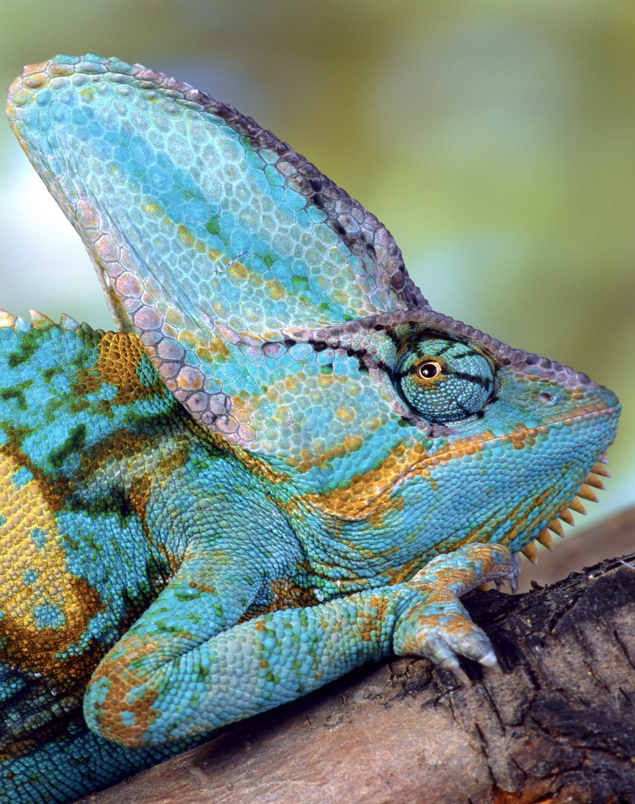

# Chameleon Eyes

A chameleon can point each eye in a different direction at the same time. One eye scans the branch overhead while the other watches the leaf below. When something worth eating shows up, both eyes swing onto it, and the chameleon judges the distance well enough to hit it with its tongue.

This project builds a robot head that sees the same way. A 3D-printed chameleon head carries two cameras for eyes, and each one sits on its own pan/tilt servo mount. The eyes can wander independently. When their views overlap, the head works out how far away things are using stereo vision.

## How it works

- **The body** is the [Chameleon Surveillance Camera](https://makerworld.com/en/models/3082701-chameleon-surveillance-camera#profileId-3472171) model from MakerWorld, painted to match the photo above.
- **The eyes** are two IMX219 camera modules (the Raspberry Pi Camera v2 sensor) on MIPI-CSI ribbon cables, connected through the Arduino UNO Media Carrier. Each rides on two hobby servos: a Hitec HS-322HD for pan and an HS-55 for tilt.
- **The brain** is an [Arduino UNO Q](https://www.arduino.cc/product-uno-q), which has two processors on one board:
  - an STM32 microcontroller that drives the servos and logs timestamped angles;
  - a Linux computer (Qualcomm QRB2210, Debian) that captures video from both cameras and runs OpenCV.

## The hard part

Ordinary stereo cameras are bolted together and calibrated once. These eyes move, so the geometry between them changes all the time. The head has to:

1. know exactly where each eye is pointing, from the commanded servo angles, calibrated against the camera;
2. match each video frame to the servo angles at the moment it was captured;
3. recompute the relative pose of the two eyes for every frame pair, using a one-time hand-eye calibration.

Once that works, the head can do things a fixed stereo rig can't. One eye can scan the room while the other holds a target, and then both eyes can snap onto the target to measure its distance.

## Optional extra

A separate small analog camera can broadcast live video over a 5.8 GHz FPV link (SP831TX transmitter), so you can watch what the chameleon sees from across the room. The eye cameras themselves can't feed the transmitter.

## Project documents

- [PLAN.md](PLAN.md): goals, architecture, build steps, calibration pipeline and risks
- [HARDWARE.md](HARDWARE.md): parts list with approximate costs

## Status

Bench bring-up. The UNO Q runs, the two processors talk to each other, and both cameras deliver images to OpenCV. The servos are not wired yet and the head is not printed. The changelog in [PLAN.md](PLAN.md) has the details.

## License

See [LICENSE](LICENSE).
